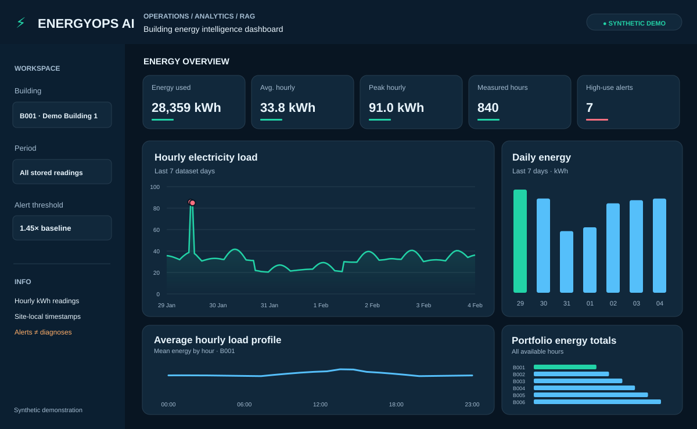
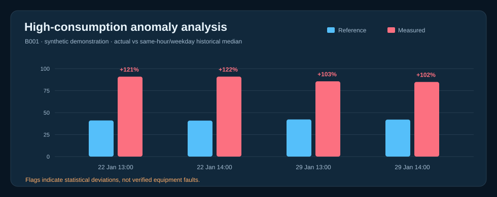
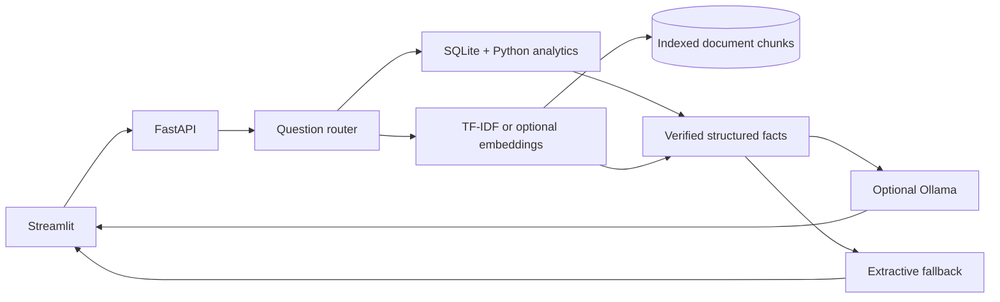

# ⚡ EnergyOps AI — Energy Operations RAG Assistant

A runnable **portfolio MVP** combining deterministic energy analytics with document retrieval and optional local LLM synthesis.

## Project overview

**EnergyOps AI** is an open-source portfolio prototype that combines energy consumption analytics with retrieval-augmented generation (RAG). It helps users explore building electricity and weather measurements through interactive Streamlit dashboards, identify unusually high energy usage using reproducible statistical baselines, and ask natural-language questions grounded in indexed technical documents. A FastAPI backend handles data queries and PDF/text retrieval; optional Ollama integration synthesizes evidence-based responses. The project includes synthetic demonstration data, automated tests, Docker configuration, and an importer for the historical Building Data Genome 2 (BDG2) dataset.

**Typical use cases:** building energy monitoring, historical consumption comparisons, anomaly triage, HVAC documentation lookup, and evidence-backed energy operations reporting. **Limitations:** anomaly detection does not establish root cause; the default retriever is TF-IDF, and LLM synthesis is optional. This is a demonstration system, not a safety-critical or production energy-control platform.

> **Dataset disclaimer:** The bundled electricity readings, weather temperatures and operating procedures are **synthetic demonstrations**, not facility measurements or real safety guidance. Do not use this application to make operational/safety decisions.


## Dashboard previews

The following are **illustrative graphics generated from the built-in synthetic demo dataset**, not screenshots of a deployed service.





### Dashboard visualizations

The Streamlit interface includes five KPI indicators, a selectable building and time window, hourly electricity trends with marked alerts, daily consumption bars, a six-building portfolio comparison, average hourly and weekday patterns, a daily/hourly usage heatmap, outside-temperature scatterplots, anomaly baseline comparisons, CSV downloads, and a document-grounded AI assistant. The anomaly threshold is adjustable from the sidebar. The selected timeframe is relative to the **newest stored reading** rather than today's date.

**Run the interactive dashboard:** `docker compose up --build` and open [http://localhost:8501](http://localhost:8501), or run the API and Streamlit locally as described below.

## Features

- **Energy monitoring:** hourly kWh, outside temperatures and building lists through a FastAPI REST service.
- **Anomaly detection:** a no-lookahead median using 1–4 preceding weeks at the *same weekday and hour*. Shows actual kWh, baseline and percentage deviation. No implied causal diagnosis.
- **Document retrieval (RAG retrieval layer):** chunk technical text/PDFs and answer with source excerpts, citation markers and optional page numbers.
- **Optional local LLM:** connect Ollama for constrained natural-language synthesis. Without Ollama, users see explicit extractive responses, **not falsely labeled LLM answers**.
- **Retrieval options:** reproducible TF-IDF default; optional Sentence Transformers semantic embeddings (a downloaded model is required).
- **Dashboard:** Streamlit charts, anomaly tables, grounded assistant Q&A and PDF/text indexing.
- **Real data integration:** BDG2 wide CSV subset importer with building metadata and optional temperature join.
- **Engineering:** SQLite with parameterized queries; tests, GitHub Actions, Docker Compose and configuration by environment variables.

## Quick start

Python **3.11+** is required.

```bash
git clone https://github.com/Subashsuresh99/energyops-ai-rag-assistant.git
cd energyops-ai-rag-assistant
python -m venv .venv
source .venv/bin/activate             # Windows: .venv\Scripts\activate
pip install -e '.[dashboard,dev]'
uvicorn energyops.api:app --reload
```

The API seeds six synthetic buildings on first start. Open **http://localhost:8000/docs**.

In a second shell (same environment), run:

```bash
streamlit run src/energyops/dashboard.py
```

Open the dashboard at **http://localhost:8501**. Or run both services via `docker compose up --build`.

## API examples

```bash
curl http://localhost:8000/health
curl http://localhost:8000/buildings
curl http://localhost:8000/summary
curl 'http://localhost:8000/anomalies?building_id=B001&threshold_ratio=1.45'
curl -X POST http://localhost:8000/ask -H 'Content-Type: application/json' -d '{"question":"Why is B001 unusual electricity consumption high?"}'
```

| Endpoint | Purpose |
| --- | --- |
| `GET /health` | API status |
| `GET /buildings` | Building IDs, including demo flags |
| `GET /readings/{building_id}` | Timestamped readings |
| `GET /summary` | Consumption totals over all stored readings |
| `GET /anomalies` | Historical high-consumption deviations |
| `GET /documents` | Indexed document metadata |
| `POST /documents` | Add plain-text document |
| `POST /ask` | Routed analytics + document retrieval |

The assistant does **not** yet interpret relative date ranges such as "last week" or "yesterday"; its fallback explains that calculations cover the stored dataset.

## Optional Ollama LLM

Install Ollama separately, pull a model and start its server:

```bash
ollama pull llama3.2
ollama serve
export ENERGYOPS_USE_OLLAMA=true
export ENERGYOPS_OLLAMA_MODEL=llama3.2
uvicorn energyops.api:app --reload
```

Default Ollama URL is `http://localhost:11434`. The model is **not bundled** in GitHub. Without Ollama, results are transparent extractive evidence with numerical analytics.

For optional semantic retrieval:

```bash
pip install -e '.[embeddings]'
export ENERGYOPS_EMBEDDING_MODEL=sentence-transformers/all-MiniLM-L6-v2
```

The default TF-IDF mode requires no model download. This MVP **does not implement** hybrid reranking, a persistent pgvector store, an agent framework, authentication or production-grade evaluation; those are future improvements.

## Real dataset: Building Data Genome 2 (BDG2)

See [original BDG2 project](https://github.com/buds-lab/building-data-genome-project-2). Obtain the CSV files yourself; this repository does not redistribute them.

Expected input paths:
- `data/raw/electricity.csv`: timestamp column + one column per building (wide layout).
- `data/raw/metadata.csv`: building_id, site_id.
- `data/raw/weather.csv`: timestamp, site_id and airTemperature (optional).

```bash
export ENERGYOPS_DB_PATH=data/bdg2_subset.sqlite3
python scripts/import_bdg2.py --electricity data/raw/electricity.csv --metadata data/raw/metadata.csv --weather data/raw/weather.csv --max-buildings 8 --max-hours 1200
uvicorn energyops.api:app --reload
```

The loader skips missing and negative kWh values, does not replace missing data with zero, and refuses to overwrite existing non-demo data. **BDG2 timestamps are site-local naive timestamps**, not globally time-zone-aligned measurements.

## Add reference documents

```bash
python scripts/ingest_pdf.py /path/to/searchable.pdf
```

CLI ingestion preserves original page numbers; the dashboard flattens PDF text and does not preserve page references. Scanned PDFs require OCR. Only index documents you have permission to use and share.

## Test and evaluate

```bash
pip install -e '.[dev]'
pytest
python scripts/evaluate.py
```

The evaluation script checks five synthetic document queries for hit@3. It **does not establish** real-world retrieval accuracy, LLM faithfulness, cost or latency. See [evaluation limitations](docs/EVALUATION.md).

## Architecture



**Principle:** Numbers come from reproducible SQL/Python functions; document guidance comes from retrieved source passages. An unexpected measurement alone does not prove a cause.

## Repository layout

```text
src/energyops/      Python API, analytics, storage, retrieval, assistant and UI
scripts/            BDG2 importer, PDF ingestion and sanity-check evaluation
tests/              Automated checks
docs/               Architecture, limitations and evaluation plan
.github/workflows/   Python CI
compose.yaml        API + dashboard
```

## License

MIT. Dependencies and third-party datasets have their own respective licenses.
